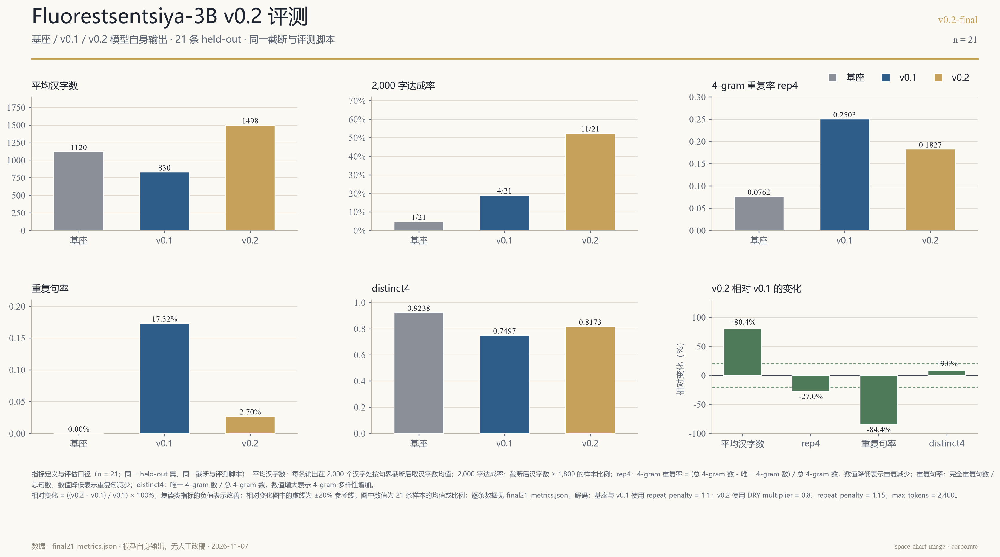

# Fluorestsentsiya-3B-Preview (v0.2)

**A locally runnable 3B Chinese narrative-writing model with a controllable old-translation register.**

[](docs/changelog-v0.2.md)
[](https://huggingface.co/Qwen/Qwen2.5-3B-Instruct)
[](#at-a-glance)
[](LICENSE)

Fluorestsentsiya-3B-Preview is a 3.09B-parameter Chinese narrative model built by training a rank-16 LoRA adapter on Qwen2.5-3B-Instruct. It targets the Chinese “old translation” register used for nineteenth-century Russian fiction, while retaining instruction-following for continuation and scene writing.

**v0.2 is a measured release, not a human-level writer.** On 21 held-out prompts, model-only outputs reach 1,497.7 mean Chinese characters, 11/21 at 1,800+ characters, rep4 0.1827, duplicate-sentence rate 2.70%, and distinct4 0.8173. v0.2 improves length and exact repetition over v0.1, but does not reach 21/21 at 2k and does not improve distinct4 by 20%.

- **Paper:** [`docs/paper-v0.2.md`](docs/paper-v0.2.md)
- **Model card:** [`docs/model-card-v0.2.md`](docs/model-card-v0.2.md)
- **21-sample evaluation:** [`bench/v0.2/README.md`](bench/v0.2/README.md)
- **Legacy v0.1 report:** [`docs/legacy-v0.1.md`](docs/legacy-v0.1.md)
- **Changelog:** [`docs/changelog-v0.2.md`](docs/changelog-v0.2.md)

`adapters/` and `gguf/` are release assets rather than tracked in the git tree; `MANIFEST.md` describes the full distribution. The v0.2 GitHub release includes the adapter ZIP and LoRA GGUF. The 1.93 GB base Q4_K_M GGUF is **not attached** to that release: GitHub returned HTTP 422 on upload. Use the Hugging Face base + PEFT, or convert the HF base to GGUF yourself.

> **License.** Research use only, non-commercial. Training corpora are user-supplied and are not redistributed. Model weights and outputs must not be used commercially.

---

## Contents

- [At a glance](#at-a-glance)
- [News](#news)
- [Results](#results)
- [Metric definitions](#metric-definitions)
- [Quick start](#quick-start)
- [Repository layout](#repository-layout)
- [Data and training](#data-and-training)
- [Evaluation and reproduction](#evaluation-and-reproduction)
- [Limitations](#limitations)
- [Citation and license](#citation-and-license)

---

## At a glance

| Item | Value |
|---|---|
| Model | Fluorestsentsiya-3B-Preview v0.2 |
| Base | Qwen2.5-3B-Instruct (3.09B) |
| Adapter | LoRA r=16, α=32, dropout=0.05, 29.9M parameters |
| Adapter file | `adapters/fluorestsentsiya-3b-preview-v0.2/` |
| Inference | base GGUF Q4_K_M + LoRA GGUF f16 |
| Base GGUF | convert from Qwen2.5-3B-Instruct; not attached to v0.2 release |
| LoRA GGUF | `gguf/fluorestsentsiya-3b-preview-v0.2-lora-f16.gguf` |
| v0.1 GGUF | `gguf/fluorestsentsiya-3b-preview-Q4_K_M.gguf` |
| Context | 8192 |
| Hardware | Ryzen 9 8945H / Radeon 780M / 32 GB |
| License | non-commercial research only |

## News

- **2026-11-07 — v0.2:** 2k-oriented adapter, 21-sample model-only evaluation, Corporate-style chart, paper and model card.
- **2026-11-05 — v0.1:** initial register adapter, Q4_K_M GGUF, Lech/POLLUX/Burrows report.

## Results

21 held-out prompts; all outputs are model-generated; no human rewrite, no 7B teacher, no API call at inference. Outputs are trimmed at 2,000 Chinese characters on a sentence boundary.

| Version | Mean CJK | 2k hit | rep4 | Duplicate sentence | distinct4 |
|---|---:|---:|---:|---:|---:|
| Base Qwen2.5-3B | 1,120.2 | 1/21 | 0.0762 | 0.00% | 0.9238 |
| v0.1 | 830.1 | 4/21 | 0.2503 | 17.32% | 0.7497 |
| **v0.2** | **1,497.7** | **11/21** | **0.1827** | **2.70%** | **0.8173** |

v0.2 vs v0.1: mean CJK +80.4%; rep4 −27.0%; duplicate sentence −84.4%; distinct4 +9.0%.



The chart is generated deterministically from [`bench/v0.2/final21_metrics.json`](bench/v0.2/final21_metrics.json); no image-generation model is used for the numbers.

### Example outputs: v0.1 vs v0.2

The original three examples are preserved under `examples/*_v0.1.md`; v0.2 was generated once from the same prompts and target lengths under `examples/*_v0.2.md`. The full prompts, settings, and metric table are in [`examples/README.md`](examples/README.md).

| Prompt | v0.1 | v0.2 |
|---|---|---|
| 入冬 / 500 | 581 CJK, rep4 0.2270 | 308 CJK, rep4 0.0164 |
| 药与酒 / 1,000 | 971 CJK, rep4 0.1791 | 432 CJK, rep4 0.0777 |
| 空下来的手 / 2,000 | 1,837 CJK, rep4 0.4974 | 2,024 CJK, rep4 0.1212 |

v0.2 has much lower exact repetition, but stops below the target on the 500- and 1,000-character prompts. The v0.1 files were produced by an earlier multi-pass/edited pipeline; this is an illustrative comparison, not a controlled length-matched experiment.

## Metric definitions

- **Mean CJK characters:** mean number of Chinese characters after trimming each output at 2,000 characters on the last sentence boundary before the limit.
- **2k hit:** fraction of the 21 samples with ≥1,800 Chinese characters after trimming.
- **rep4:** 4-gram repetition rate = (total 4-grams − unique 4-grams) / total 4-grams; a lower value indicates less repetition.
- **Duplicate sentence rate:** exactly repeated sentences / total sentences; a lower value indicates fewer repeated sentences.
- **distinct4:** unique 4-grams / total 4-grams; a higher value indicates greater 4-gram diversity.
- **Relative change:** ((v0.2 − v0.1) / v0.1) × 100%. For repetition metrics, a negative value is an improvement.

The metrics are surface diagnostics. They do not measure role consistency, causal coherence, or literary quality; those were not blind-rated at n=21.

## Quick start

### 1. GGUF + LoRA (recommended, llama.cpp)

Get a Qwen2.5-3B-Instruct Q4_K_M GGUF first (from Hugging Face, or convert the HF base). The base GGUF is not attached to the v0.2 release; the adapter and LoRA are.

```bash
llama-server \
  -m <path>/qwen25-3b-base-Q4_K_M.gguf \
  --lora gguf/fluorestsentsiya-3b-preview-v0.2-lora-f16.gguf \
  -ngl 99 -c 8192 -t 8 -b 2048 -ub 512 -fa on \
  -ctk q8_0 -ctv q8_0 --jinja \
  --temp 0.7 --top-p 0.9 --repeat-penalty 1.15 \
  --dry-multiplier 0.8 --dry-base 1.75 \
  --dry-allowed-length 2 --dry-penalty-last-n 2048
```

Then call the OpenAI-compatible endpoint:

```bash
curl http://127.0.0.1:8087/v1/chat/completions \
  -H "Content-Type: application/json" \
  -d '{
    "model": "local",
    "messages": [
      {"role": "system", "content": "你是中文小说家，译笔取法十九世纪俄国文学的旧译。只写正文。"},
      {"role": "user", "content": "写一个约 2000 字的中文短篇：省城冬天，一个车夫在雪夜拉一个不肯说目的地的客人。"}
    ],
    "max_tokens": 2400,
    "temperature": 0.7,
    "top_p": 0.9,
    "repeat_penalty": 1.15
  }'
```

### 2. PEFT adapter

```python
from transformers import AutoModelForCausalLM, AutoTokenizer
from peft import PeftModel

base = "Qwen/Qwen2.5-3B-Instruct"
model = AutoModelForCausalLM.from_pretrained(base, torch_dtype="auto", device_map="auto")
model = PeftModel.from_pretrained(model, "adapters/fluorestsentsiya-3b-preview-v0.2")
tok = AutoTokenizer.from_pretrained(base)
```

## Repository layout

```text
adapters/
  fluorestsentsiya-3b-preview/          v0.1 register adapter
  fluorestsentsiya-3b-preview-format/   v0.1 format variant
  fluorestsentsiya-3b-preview-v0.2/     v0.2 adapter (release asset)
base/                                   Qwen2.5-3B-Instruct (Apache-2.0, release asset)
bench/
  lech_prompts.jsonl
  style_prompts.jsonl
  v0.2/                                 21-sample model-only evaluation
docs/
  paper-v0.2.md                         full paper-format report
  model-card-v0.2.md
  changelog-v0.2.md
  legacy-v0.1.md                        preserved v0.1 report
examples/
  README.md                             v0.1/v0.2 prompts and comparison table
  *_v0.1.md                             preserved v0.1 references
  *_v0.2.md                             regenerated v0.2 comparisons
  v0.2/                                 three raw v0.2 held-out outputs
gguf/
  qwen25-3b-base-Q4_K_M.gguf              local base; convert from Qwen HF
  fluorestsentsiya-3b-preview-Q4_K_M.gguf v0.1
  fluorestsentsiya-3b-preview-v0.2-lora-f16.gguf
scripts/                                data, training, evaluation, export
```

## Data and training

- **Corpus:** user-supplied Chinese translations of Chekhov and Dostoevsky; not redistributed.
- **SFT:** 248 curated 2k continuation examples; 1,200 sliding-window examples; 12 offline teacher continuations used only for data construction.
- **v0.2 training:** continue the v0.1 adapter for 25 steps, sequence 2,048, lr 1e-5, AdamW, bf16, gradient checkpointing, 8 CPU threads.
- **Selected checkpoint:** step 15, by held-out surface metrics.
- **Inference:** 3B only; the teacher is not loaded; no 7B, no API.
- **Repetition control:** DRY multiplier 0.8, base 1.75, allowed length 2, penalty last-n 2,048.

## Evaluation and reproduction

The full protocol and per-sample table are in [`bench/v0.2/README.md`](bench/v0.2/README.md). The chart script is [`bench/v0.2/make_chart21_corporate.py`](bench/v0.2/make_chart21_corporate.py).

```bash
python bench/v0.2/make_chart21_corporate.py
```

The script reads `bench/v0.2/final21_metrics.json` and writes `bench/v0.2/final21_bar_corporate.png`. It uses a deterministic plotting backend, so the numbers are not altered by an image model.

## Limitations

- **11/21 reach 1,800+ characters**, not 21/21; mean 1,498.
- **distinct4 +9.0%**, not +20%; the human target on the same 21 prompts is 0.9534, only +14.9% over v0.1. The metric is near its ceiling.
- **Base is not a clean winner:** base rep4 0.0762 and distinct4 0.9238 are better, but base writes only 1,120 characters and reaches 2k in 1/21. This is a length effect, not a completed task.
- **Role/causal consistency** was not blind-rated at n=21.
- **Benchmark scope:** v0.2 does not re-run Lech/POLLUX/WPB/Burrows; v0.1's original numbers are in `docs/legacy-v0.1.md` and must not be mixed with the v0.2 table.
- **CWB 4.36** from the parent project is contaminated by 10/12 prompts and is not reused.
- **Semantic loops and cross-story drift** can still occur at long lengths.

## Citation and license

If you use the model or code, cite the repository via [`CITATION.cff`](CITATION.cff):

```bibtex
@misc{fluorestsentsiya3b2026v02,
  title  = {Fluorestsentsiya-3B-Preview v0.2: A 3B Chinese Narrative Model at the 2,000-Character Frontier},
  author = {Fluorestsentsiya-3B-Preview contributors},
  year   = {2026},
  note   = {Version 0.2},
  url    = {https://github.com/ktznl01/Fluorestsentsiya-3B-Preview}
}
```

The repository is released under the **Fluorestsentsiya-3B-Preview Non-Commercial Research License** (see [`LICENSE`](LICENSE)). The base model remains Apache-2.0. Training corpora are not redistributed. The model imitates a prose register, not a living author; outputs should not be presented as human-authored text.

Base model: Qwen2.5-3B-Instruct (Apache-2.0). Inference: llama.cpp (MIT). The v0.1 report used WritingBench-Critic-Model-Qwen-7B (Apache-2.0) only as an offline judge; v0.2 does not use a 7B model at inference.
